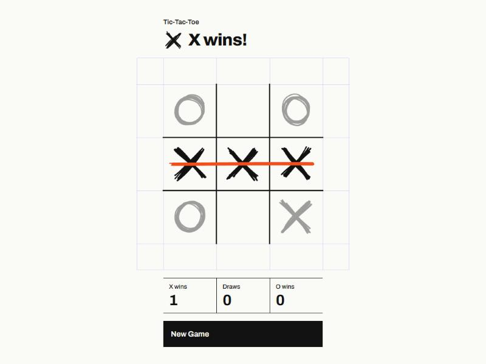

# Tic-Tac-Toe

Two players, one screen. X goes first. The game calls the winner or a draw, strikes through the winning line, and keeps a running score. **New Game** clears the board and keeps the score; whoever didn't open the last game opens the next one.

Live: https://tic-tac-toe-react-app-sigma.vercel.app



## Design

The board sits on a visible construction grid, and the marks are the one loose thing on it. Every X and O is a procedural marker scribble in SVG: an X is a bundle of overlapping strokes, an O is several wobbly loops. Each mark is seeded by its square, so it looks hand-drawn but renders the same on the server, the client and every reload. Marks draw on in about 200ms, the winning strike lands in orange, and everything it didn't strike steps back.

- Hover or focus an empty square to see a faint preview of the mark you're about to place.
- Squares use `aria-disabled`, not `disabled`, so keyboard focus stays put after a move.
- Light and dark follow the system. All motion stops under `prefers-reduced-motion`.
- Works down to 320px wide.

## Run it

```bash
npm install
npm run dev     # http://localhost:3000
npm test        # Vitest + React Testing Library
npm run build
```

## How it's put together

- `lib/game.ts` holds the rules: the eight win lines and `calculateResult`.
- `lib/gameReducer.ts` is a pure reducer for board, turn, result and scores.
- `lib/scribble.ts` generates the marker strokes from a seed.
- `components/` renders that state. Squares are real `<button>` elements.
- `app/icon.svg`, `app/favicon.ico` and `app/apple-icon.png` are the favicon set.

Built with Next.js, React 19 and Tailwind CSS.
