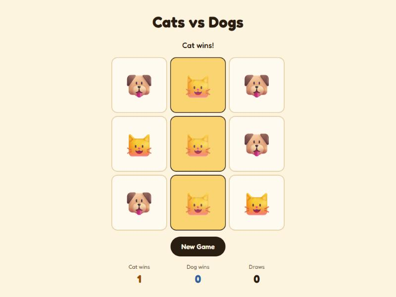

# Cats vs Dogs: Tic-Tac-Toe

A two-player Tic-Tac-Toe game built with Next.js, React 19 and Tailwind CSS. Cat plays first, Dog second. The game announces a winner or a draw, highlights the winning line, and keeps a running score across games. **New Game** clears the board and keeps the score; the player who didn't open the last game opens the next one.

Live: https://tic-tac-toe-react-app-sigma.vercel.app



## Run it

```bash
npm install
npm run dev     # http://localhost:3000
npm test        # Vitest + React Testing Library
npm run build
```

## How it's put together

- `lib/game.ts` holds the rules: the eight win lines and `calculateResult`.
- `lib/gameReducer.ts` is a pure reducer for board, turn, result and scores.
- `components/` renders that state. Squares are real `<button>` elements, so keyboard play and screen readers work without extra code.
- `lib/marks.ts` sets the theme. Change the names and glyphs there to reskin the game.
